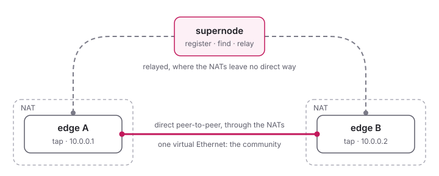

<!--
SPDX-License-Identifier: GPL-3.0-only
SPDX-FileCopyrightText: Copyright 2022 n2n contributors
SPDX-FileCopyrightText: Copyright Hamish Coleman
SPDX-FileCopyrightText: Copyright Honey Bunny QT
-->

# n3n-be (Bunny Edition)

[](https://github.com/HoneyBunnyQT/n3n-be/actions/workflows/quick.yml)
[](https://github.com/HoneyBunnyQT/n3n-be/actions/workflows/netns.yml)
[](https://github.com/HoneyBunnyQT/n3n-be/actions/workflows/sanitizers.yml)
[](https://github.com/HoneyBunnyQT/n3n-be/actions/workflows/interop.yml)
[](https://github.com/HoneyBunnyQT/n3n-be/actions/workflows/fuzz.yml)
[](https://github.com/HoneyBunnyQT/n3n-be/tags)
[](LICENSE.md)

**An independent project derived from n3n, compatible with n3n v3
networks.**

A lightweight peer-to-peer VPN: computers anywhere become one virtual
Ethernet network, a _community_.  They reach each other directly wherever
their NATs let them, and through a supernode where they do not.



- An **edge** runs on each computer of the network.  It gives the
  computer a virtual network device (TAP, or TUN) with an address in the
  community, and encrypts what it sends with the community's key.
- A **supernode** is where the edges register and find each other, and
  it relays what cannot go directly - without the key, which it never
  needs.  One supernode serves many communities, several supernodes can
  form a federation, and a supernode can be an edge as well.

Both are one program, `n3n`, installed also as `n3n-edge` and
`n3n-supernode`, for Linux, Windows, macOS, the BSDs, OpenWrt and
Android.

## Getting started

- [Installing](quick_start/Install.md): the packages and downloads
- [Your First Network](quick_start/Config.md): a supernode and two edges,
  in a few minutes

## What n3n-be adds

n3n-be grew out of [n3n](https://github.com/n42n/n3n), which grew out of
[n2n](https://github.com/ntop/n2n).  It speaks their protocol: its edges
and supernodes work together with those of n3n and of n2n 3.x, and a test
checks that against upstream n3n every week.  On top of it:

- **More NATs get through:** each edge finds out what kind of NAT it is
  behind, and guesses the ports of a peer behind a hard (symmetric) NAT,
  with a pool of sockets for the peer to meet
- **Networks change:** IPv6 next to IPv4, roaming from one network to
  another without losing the peers, TCP when UDP is blocked and back
- **Faster:** packet threads, and datagrams sent and received several at
  a time - up to a third more throughput for small packets
- **Easier to run:** reload on SIGHUP, systemd notify and watchdog, a
  management page, communities in the configuration file
- **More places:** TUN mode for macOS and Android, an
  [Android app](https://github.com/HoneyBunnyQT/n3n-be/tree/main/android),
  multicast for protocols without IP (PROFINET, NetBEUI)

Every change is tested hard: each push runs dozens of NAT scenarios in
network namespaces, the same under the sanitizers, fuzzers, and interop
tests with releases of n3n and n2n (see [Testing](develop/testing.md)).

## Documentation

- [Configuration](configure/index.md): edges, supernodes, communities,
  security, and [every option](configure/Options.md)
- [Advanced Topics](advanced/index.md): NAT traversal, routing, bridging,
  traffic filters, threads
- [Tools](Tools.md), [Scripts](Scripts.md) and the [FAQ](FAQ.md)
- [Internals](internals/index.md): the management API, the cryptography,
  the protocol
- [Development](develop/index.md): building, testing, the
  [Roadmap](develop/Roadmap.md), [Contributing](Contributing.md)
- [Security Policy](SECURITY.md): how to report a vulnerability

The man pages `n3n(8)`, `n3n-edge(8)`, `n3n-supernode(8)` and `n3n(7)`
come with the program.  The documentation is also a website, built with
[MkDocs](https://www.mkdocs.org/): `pip install mkdocs`, then `make docs`
(into `site/`) or `make docs_serve` to read it at http://127.0.0.1:8000.

## Building

```sh
./autogen.sh && ./configure && make
make test
```

See [Building from Source](build/index.md) for the options and other
systems.

## Licence

Free software, for anyone to use, commercial use included: n3n-be's own
work is under the AGPL-3.0, what came from n3n and n2n keeps its GPL.
Changes to it stay open, also when they only run as a service.  See
[Licence](LICENSE.md).
