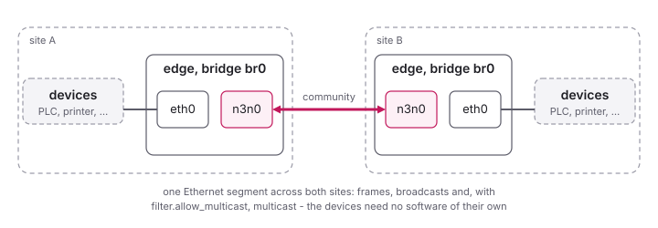

<!--
SPDX-License-Identifier: GPL-3.0-only
SPDX-FileCopyrightText: Copyright Dylan Yee
SPDX-FileCopyrightText: Copyright Hamish Coleman
SPDX-FileCopyrightText: Copyright Honey Bunny QT
-->

# Bridging (Linux)

An edge's TAP device can be part of a network bridge, together with an
Ethernet port of its host.  The devices on that port's network then are
in the community too, without software of their own: with a bridge at
two sites, their networks become one Ethernet segment.  This suits
devices that cannot run an edge - PLCs, printers, old machines - and
protocols that need one segment, such as discovery by broadcast.



## Setting it up

At each site, the edge needs `filter.allow_routing = true` - it takes
frames for other MAC addresses than its own then - and a static address
or none:

```ini
[community]
name = plant
key = mysecretpass
supernode = sn.example.org:7654

[tuntap]
name = n3n0
address = 10.66.0.1/24
address_mode = static

[filter]
allow_routing = true
# allow_multicast = true    # if the devices discover each other by multicast
```

Then the bridge, with `ip` (after the edge has started, so that `n3n0`
exists):

```sh
sudo ip link add br0 type bridge
sudo ip link set eth0 master br0
sudo ip link set n3n0 master br0
sudo ip link set br0 up
```

The host's own address moves from `eth0` to `br0`: a port of a bridge
has none of its own.  Doing this over a remote connection through `eth0`
cuts it; set it up in the system's network configuration
(systemd-networkd, NetworkManager, `/etc/network/interfaces`), so that it
comes up at boot.

The bridge needs a TAP device; with TUN (`tuntap.type = tun`) there are
no Ethernet frames to bridge.

## How it works

The edge learns where the devices are, as a switch does.  A frame from a
peer edge carries, inside, the MAC address of the device that sent it:
the edge remembers that this device is behind that peer.  A frame from
the bridge to that device then goes to that peer only; a frame to a
device not known yet goes to the supernode, as one to an edge it does
not know.  An entry nobody has heard from for five minutes is forgotten.
The devices' MAC addresses travel inside the frames, encrypted with the
community's key.

The first frames of a conversation are usually broadcasts - ARP asking
for an address - which reach every edge, so the answer teaches the edges
where the device is.

## Broadcasts and multicast

The community is one broadcast domain: a broadcast from a device behind
one edge's bridge reaches every edge, and the devices behind their
bridges.  Multicast does the same where the edges allow it
(`filter.allow_multicast`), also that of protocols without IP, such as
the discovery of PROFINET devices (DCP).  The IEEE 802.1 link-local
frames - spanning tree, LLDP and the like - never pass, as through any
bridge.  See [Broadcast and
multicast](../configure/TapConfiguration.md#broadcast-and-multicast).

## Routing or bridging

`filter.allow_routing` is for both: with a bridge, the edge learns the
devices behind its peers, as above; for routing, see
[Routing](Routing.md).  Should the learning get in the way of a special
routing setup, building without `-DHAVE_BRIDGING_SUPPORT` (in the
`Makefile`) leaves it out.
