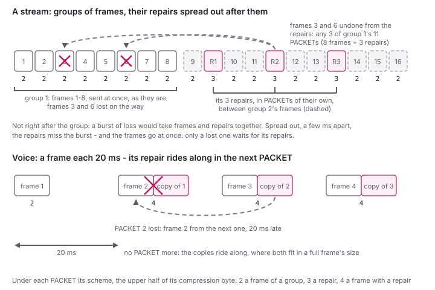
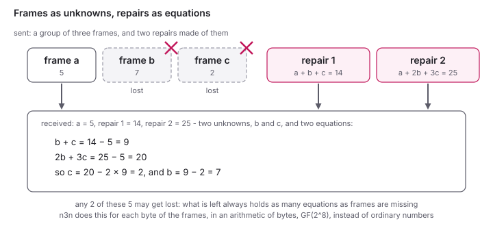

<!--
SPDX-License-Identifier: AGPL-3.0-only
SPDX-FileCopyrightText: Copyright Honey Bunny QT
-->

# Forward Error Correction

On a line that loses packets - a weak radio link, an overloaded uplink, a
bad peering leg - every lost packet costs: a voice call crackles, a game
stutters, a ping goes unanswered, and TCP, which takes a loss for
congestion, slows down.  Sending through the supernode helps when only the
direct path loses (see [NAT Traversal](NatTraversal.md#a-direct-path-that-loses-packets)),
not when the loss is on the edge's own line, which both ways share.

With forward error correction the sending edge sends some redundancy
along, computed from what it sent, so that the receiving edge can undo a
loss itself, at once, without asking for anything again - "forward"
because the means to repair go ahead with the data, instead of the
receiver asking back for what it missed.  It costs extra
packets - which, where they undo a loss, save what TCP would otherwise
have sent again, and the time it would have waited for that.

> Under development: what goes on the wire may still change before it is
> part of a release.  Give all edges of a community the same build when
> switching it on.

## Switching it on

```
[community]
fec = auto
```

on every edge of the community.  An edge that does not know it drops the
PACKETs that carry it ("decompression: failed: unsupported" in its log), as
with a compression it does not know - so first every edge, then the
setting.  The supernodes pass such PACKETs on as any others; they need
nothing.  It can be changed while the edge runs (`n3nctl reload`).

- `none`, the default: PACKETs as ever, which every version of n3n reads
- `auto`: frames to a peer go in groups, and after each group as many
  repairs as the loss on the way to that peer asks for - none while
  nothing is lost
- `always`: as `auto`, but at least one repair per group, whatever the
  loss - for testing, or for a line known to be bad

Every edge reads all of them, whatever its own setting.

## What it does

The frames to a peer go in **groups**: up to 32 frames, or what comes in
10 ms, whichever is first - so a stream at a high rate makes groups of 32,
a voice call (a frame each 20 ms) groups of one.  The frames go as they
are, at once; after the group, **m repairs** follow, computed from its
frames with a Reed-Solomon code - the kind of code that lets a scratched
CD play and a smudged QR code scan.  The receiving edge keeps the frames
of a group as they come; where some are missing, **any m of them** are
undone from the repairs, as soon as enough of them came (how that can
be: [below](#how-a-repair-brings-a-frame-back)).  A group with
more lost than it has repairs keeps its losses, but nothing more.

The repairs do not go right after their group's last frame, but spread
out over the next few milliseconds - so that a burst of loss, which
takes several packets in a row, does not take a frame and what is to
undo it together.  A repair **rides along** in the next frame's PACKET to
the same peer where both fit (in a full frame's size), and goes in a
PACKET of its own where they do not, or where no frame comes for long.
So a small frame's repair at a low rate - voice, a game, pings - is a
copy of it in the next PACKET, at no extra PACKETs; the repairs of big
frames - a download - go on their own.



How many repairs a group gets follows the loss: each edge counts the
frames it gets from each peer (they carry sequence numbers), and tells
the peer, in the PACKETs it sends to it, what it sees lost - and, where
something is lost, how long the bursts of loss are, and how many frames
stayed lost although repairs came.  The sender takes the fewest repairs
that leave at most 0.1 % of the frames lost - given the loss it is told,
half as much again for safety - but at most half as many as the group has
frames (one for one, for a group of one).  Where losses come one by one:

| loss told | group of 10 | group of 32 |
|---|---|---|
| 1 % | 2 (20 %) | 3 (9 %) |
| 5 % | 5 (50 %) | 8 (25 %) |
| 10 % | 5 (50 %) | 12 (38 %) |
| 20 % | 5 (50 %) | 12 (38 %) |

The more is lost, the more redundancy goes - and the bigger the groups,
the less of it is needed for the same: losses even out over more frames.
Where no edge tells (traffic one way only), the sender goes by what it
sees lost of the peer's PACKETs to it, as if the loss were the same both
ways.

**Bursts.** Many lines lose several packets in a row - a radio fading, a
queue overflowing - and a burst takes several frames of a group, which
go in a row.  With the mean burst it is told, the sender reckons with
that: for the frames of a group, which go in a row, it takes a packet
lost right after one that was lost to be likelier than one lost after
one that came (what is called a Gilbert model); the repairs, spread out
after the group, it takes as lost one by one.  Reckoning with 2 % lost
(the margin included), a group of 20 frames gets 3 repairs where the
losses come one by one, 7 where they come in pairs, 10 where they come
in fours.  In the unit tests, of 2000 big frames over a line losing 3 %
in bursts of 4, 33 stay lost where the sender takes the losses as coming
one by one, 6 where it knows of the bursts.

**What stayed lost.** Where frames stay lost all the same, the sender
adds to its margin - a quarter more of the loss told each second, up to
four times it - and takes it back slowly while none do.

**A full line.** Repairs do not help against loss from congestion: on a
line that is full, they are what overflows it.  So now and then -
after 8 seconds of sending repairs, then twice as long apart each time
nothing came of it, up to a minute - the sender sends half the repairs
for a second, and where the loss goes down with that, to six tenths of
what it was or less, it keeps to half as many, halving again at the next
such test, and adding an eighth of what it took away every 8 seconds.
That is for streams only (groups of 4 frames or more): the repairs of a
voice call ride along, and taking them away would cost much.  In the unit
tests, a line that takes 5300 packets a second, with frames at 5000 a
second, and 3 % lost besides: with all repairs (37 % of the frames), the
line overflows and 17 % are lost; backing off, the repairs come down to
17 %, the loss to 5 %, and as many frames arrive.  On a line that
loses at random, the tests cost a little: at 10 %, 99.9 % of the frames
arrive instead of 100 %.

What it costs: 3 bytes in each PACKET to a peer (6 where something is
lost), and the repairs, each as long as the longest frame of its group: in
a PACKET of its own (5 or 8 bytes more), or riding along (9 or 12 bytes
more).  On a line that loses nothing, there are no repairs, only the 3
bytes.  A group waits 10 ms at
most, its repairs some more, up to a frame and a half at the rate of the
frames to the peer for one that rides; a frame undone comes that much
later, or less.  Broadcast and multicast go without.

With `connection.p2p_max_loss` (see [NAT Traversal](NatTraversal.md#a-direct-path-that-loses-packets)),
an edge sends a peer's frames through the supernode where the direct path
loses that much of its probes - FEC or not: the probes see the loss as it
is, before any repair.  FEC goes on through the supernode as it did
directly.  Where the loss is on the edge's own line, the way through the
supernode loses as much: `p2p_max_loss = 0` keeps the direct path, and
leaves the loss to FEC.

It works the same through a supernode: it is between the two edges, inside
the encryption.  Repairs do not help against loss from congestion - more
bytes on a full line lose more - which is why `auto` sends none while
nothing is lost, at most half as many as frames, and fewer where they
fill the line (see above).

## How a repair brings a frame back

That a few repairs can stand in for any of a group's frames sounds like
magic, but it is the algebra of school: a set of equations with as many
unknowns as equations can be solved.

Take a group of three frames, and think of each as a number: a = 5,
b = 7, c = 2.  The sender makes two repairs of them, each a sum of the
frames with weights of its own: repair 1 is a + b + c = 14, repair 2 is
a + 2b + 3c = 25.  Five PACKETs go, and frames b and c get lost.  The
receiver has a = 5 and both repairs: two equations, two unknowns.



Any two of the five may get lost - two frames, a frame and a repair, or
both repairs - and what is left always gives as many equations as frames
are missing.  A frame that came is an equation too (a = 5), only an easy
one.  So it goes for a group of k frames with m repairs: each repair is
one more equation, and any m of the k + m PACKETs may be lost.  With one
more lost than there are repairs, there is one equation too few, and the
lost frames stay lost.

Two things make this work for real frames:

- **The weights.**  For every choice of lost frames, the equations that
  are left must be solvable - none of them may just repeat what the
  others say.  The weights are taken from a table built so that this
  holds for any choice (mathematicians call it a Cauchy matrix).  Its
  first row is all ones: the first repair is the plain sum of the frames,
  and for a single lost frame it is all that is needed.
- **The numbers.**  A frame is a row of bytes, so the same is done for
  each byte position: the first bytes of all frames make one set of
  equations, the second bytes the next, and so on.  The sums are not
  those of ordinary numbers, which would grow beyond a byte, but of an
  arithmetic of 256 values - exactly what a byte holds - in which adding,
  multiplying and dividing never leave a byte, and every number but 0 can
  be divided by (a finite field, GF(2^8)).  In it, adding is the
  exclusive or of the bits (XOR: a bit of the sum is 1 where exactly one
  of the two is), so the first repair is the XOR of the frames.  Solving
  the equations is the same as at school, only with these sums.

Frames of different lengths are padded with zeros to the longest of the
group, and each frame's length is coded along with it, so that an undone
frame comes back at its own length.

## Why more packets can carry more

Repairs take a share of the line - so how can a download get faster
with them?  Because what holds TCP back on a lossy line is not the line,
but the loss: TCP takes every lost packet for a sign of congestion and
halves its pace, and it waits a round trip or more for what it sends
again.  As a rule of thumb (Mathis et al.), TCP gets at most

    1.22 x segment size / (round trip x square root of the loss)

so with segments of 1400 bytes and a round trip of 50 ms, about 2.7
Mbit/s at 1 % lost - over a line of 100 Mbit/s as over one of 10.  The
repairs undo the losses at the receiving edge, before TCP sees them: of
1 % lost, 0.1 % left gives TCP 8.6 Mbit/s, 0.01 % 27 Mbit/s.  The line
spends a tenth or a fifth on repairs that TCP was not using anyway, and
TCP gets several times what it got.  For voice, a game, a video call, a
packet sent again comes too late in any case: only a repair that is
already there helps.

That holds where the line has room to spare, and the loss is not its
being full: there, the repairs make it fuller, and lose more - which is
why `auto` backs off then (see above).

## Seeing it work

`n3nctl get_packetstats`:

- `fec`: `tx_pkt` repairs sent, `rx_pkt` frames undone
- `fec_lost`: `rx_pkt` frames from peers found missing by their sequence
  numbers, whether undone or not - the loss of the way in

`n3nctl get_edges --raw` shows, for each peer, `fec`: what the peer
tells of the way to it (`loss`, `burst`, `residual`), what the edge makes
of it (`margin`, `scale`, and `k` and `m` of its last group), and what it
sees of the way from the peer (`rx_loss`, `rx_burst`, `rx_residual`), see
[the management API](../internals/ManagementAPI.md).

The same on the metrics page (`packets`, events `fec_redundant`,
`fec_undone` and `fec_lost`) and the management page.

The netns scenario `fec-lossy` (see
[Testing behind NATs](../develop/netns_testing.md)) has a direct path that
loses 10 percent each way: of 400 pings, 97 to 98 percent are answered
(without, some 82), their repairs riding along with the next; of 2000
frames of 1200 bytes one way, all arrive (without, 90 percent), with
about one repair for two frames.

## On the wire

The PACKET's compression byte says how its payload is to be undone; its
upper half (the high nibble) now says the forward error correction - the
scheme - the lower half the compression as before (1 none, 2 LZO, 3
ZSTD).  So a PACKET without is what it always was: `0x01` is an
uncompressed one, `0x21` an uncompressed frame of a group, `0x22` one
compressed with LZO; a repair on its own goes uncompressed, `0x31`.  The
payload, decrypted and decompressed, is the frame with a trailer, by the
scheme:

| scheme (high nibble) | byte (`.`: the compression) | payload |
|---|---|---|
| 0 | `0x0.` | the frame, as ever |
| 1 | `0x1.` | frame, sequence number (16 bits), report |
| 2 | `0x2.` | a frame of a group: as 1 |
| 3 | `0x3.` | a repair: repair, first sequence number of its group (16 bits), frames in it (8 bits), number of the repair (8 bits), report |
| 4 | `0x4.` | a frame with a repair riding along: frame, repair, length of the repair (16 bits), first sequence number of its group, frames in it, number of the repair, sequence number, report |

The report, at the very end, is what the sender sees of the PACKETs from
the one it sends to: one byte where nothing is lost - 0, or 0x7f while
it does not know yet - and four where something is: the loss over longer
(percent), the mean burst (in quarters of a PACKET, 0 for none yet), what
stayed lost (per mille), and the loss lately (percent) with the top bit
set.

The sequence numbers count the frames from one edge to another, from a
number of chance; a group's have them in a row, and a repair is known by
its group and its number.  The receiver keeps a window of the last 64,
to tell what is missing, what came twice (dropped), and what is still to
be undone; a frame that leaves it missing stayed lost.

The code, in the terms of the trade (for what they mean, see
[above](#how-a-repair-brings-a-frame-back)): Reed-Solomon over GF(2^8)
with the polynomial x^8 + x^4 + x^3 + x + 1 (AES's: it says how two
bytes are multiplied), systematic - the frames go as they are, only
the repairs are computed - with a Cauchy matrix for the repairs' weights,
its first row all ones (the first repair is the XOR of the frames).  What
is coded of each frame is its length (16 bits) and the frame, padded with
zeros to the longest of the group.  See `src/fec.h` and `src/gf256.h`,
and the [Roadmap](../develop/Roadmap.md) for what is to come.

## The arithmetic

Making a repair, and undoing a frame, is the same work: each byte of k
frames multiplied by its weight and added up, in the arithmetic of bytes
above.  Most CPUs can do the same step on many bytes at once, with
instructions of their own for it (SSSE3, AVX and the like on Intel and
AMD, NEON on ARM), so the work has variants, chosen at runtime as the
ciphers' are - the fastest one the CPU has:

- plain C: a table of products, a byte at a time
- SSSE3, AVX2, AVX-512, NEON: the products of the two halves of a
  byte, looked up 16, 32 or 64 bytes at a time
- GFNI, with SSE, AVX2 or AVX-512: the CPU multiplies in GF(2^8) itself,
  with AES's polynomial - which is why it is ours (Intel from Ice Lake
  and the Atoms from Tremont, AMD from Zen 4)

They all give the same, byte for byte, so edges with different ones
understand each other.  `n3n-edge test benchmark fec_repair` measures
each of them, making a repair of 8 frames of 512 bytes:

| variant | MB/s of frames | a repair takes |
|---|---|---|
| plain C | about 1,000 | 4 µs |
| SSSE3 | 10,000 | 0.4 µs |
| GFNI | 15,000 | 0.3 µs |
| AVX2 | 17,000 | 0.25 µs |
| AVX-512 | 24,000 | 0.17 µs |
| GFNI/AVX2 | 32,000 | 0.13 µs |
| GFNI/AVX-512 | 36,000 | 0.11 µs |

(a Xeon of the Sapphire Rapids kind at 2.1 GHz, shared, so give or take
a quarter).  The sender multiplies each frame into each of its group's m
repairs: at 1 Gbit/s and 5 repairs a group, that is 625 MB/s - more than
half a core in plain C, a few percent with GFNI.  The receiver works only
where a frame is lost.
