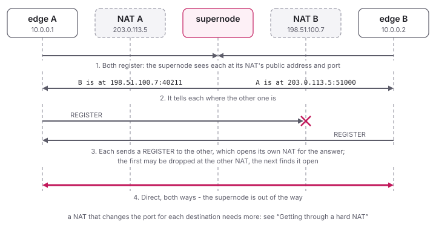

<!--
SPDX-License-Identifier: AGPL-3.0-only
SPDX-FileCopyrightText: Copyright Honey Bunny QT
-->

# NAT Traversal

Edges send their traffic straight to each other where they can, and through
the supernode where they cannot.  Most edges sit behind a NAT, so to reach a
peer an edge needs to know the public address and port the peer's NAT uses
for it - and that NAT has to let the edge's packets in.

The supernode sees each edge at its public address and tells the edges about
each other.  Both edges then send REGISTERs to each other at the same time:
each NAT sees its own edge sending out to the other one first, and lets the
answer in - "hole punching":



Whether that works depends on how the NATs map the edges' sockets: a NAT
that keeps the public port the same for every destination (most home
routers) lets it work at once; one that takes a new port for every
destination needs more, see [below](#getting-through-a-hard-nat).

## Sockets

By default an edge opens two UDP sockets, one for IPv6 and one for IPv4, on
ports the system picks (`connection.bind=[::]:0`).  Each packet leaves from
the socket for its destination's family, so an edge reaches supernodes and
peers of either family, whichever it registered over.  On a system without
IPv6 it keeps the IPv4 socket only.

`connection.bind` takes one or more addresses, separated by spaces, for
example to give a router's port forwarding a fixed port:

```
[connection]
bind=[::]:50001
```

`[::]` stands for IPv4 too: it opens `[::]` for IPv6 only and `0.0.0.0` on
the same port, unless an IPv4 address with that port is given as well.

A supernode takes the same list, by default `[::]:7654`, and answers edges
on each of the addresses alike, from the socket their packet came in on.

Loopback and local network traffic is not affected: packets to a local peer
leave from the same sockets, and edges in the same network still find each
other by multicast (see [Advanced Configuration](../configure/Advanced.md)).
IPv6 link-local peer addresses are not used, as they only work together with
their interface.

## How an edge's NAT maps it

Every answer from a supernode - to its registration and to the PING that
edges send to their supernodes every 30 seconds - tells the edge the
public address and port the supernode saw it at.  From the answers of
different supernodes, the edge sorts its NAT into one of these, separately
for IPv4 and IPv6:

| class | seen by the supernodes | meaning |
|-------|------------------------|---------|
| easy (port kept) | the same port, which is also the local one | no NAT, or one that keeps the port |
| easy (port changed) | the same public port towards every supernode | the usual home router, many carrier NATs |
| hard (ports lo-hi) | a new port for every destination | a peer would have to guess the port |
| several addresses | a different public address per supernode | more than one uplink, or a supernode in the local network |
| unknown | answers from fewer than two supernode addresses | |

Telling easy apart needs two supernodes with different addresses, for
example two federated ones: a NAT that maps per destination address shows
the same port towards two ports of one supernode.  A different port there
does show a hard NAT, so one supernode with two ports in its
`connection.bind` is enough to see that.

The class shows in the edge's management interface:

```
n3n-be-ctl get_info
    "nat4": "easy (port changed)",
    "nat6": "easy (port kept)",
```

and a change is logged, like `IPv4 NAT: hard (ports 20115-20228), as of
supernode [203.0.113.1:7654]`.

The edge also tells its peers: the REGISTER it sends through the supernode
carries a short hint with the class and, for a hard NAT, the range of ports,
rounded out to a multiple of 1024 below and a power of two in size.  An edge
shows the hint of a peer it does not reach directly yet as `nat` in
`get_edges`.  Older edges ignore the hint and send none.

## Getting through a hard NAT

| this edge | its peer | result |
|-----------|----------|--------|
| easy | easy | direct |
| easy or unknown | hard, range up to 4096 ports | direct after some rounds of guessing, a minute or two (see below) |
| hard, range up to 4096 ports | easy or unknown | the same, the peer guesses |
| any | hard, wider range | through the supernode |
| hard | hard | through the supernode, now and then direct by luck (see below) |
| any | several addresses | through the supernode, mostly (see below) |

An edge with several addresses still gets through directly where the
supernode it is registered at happens to see it at the address it also
reaches the peer from - with one uplink towards that supernode and the
peers, say, and another towards a second supernode.  Which supernode the
edge is registered at can change, and with it whether the peers get
through.

### Why a hard NAT is hard

A NAT is a door keeper with many doors - its public ports - and two
rules: a door opens only when someone inside sends out through it, and
then only for the one place sent to.  An easy NAT keeps one door per
edge, whoever it sends to: the door the supernode saw is the one peers
knock on, and once the edge sent to a peer there, it opens for that peer.
A hard NAT takes a **new door for every destination**: the door the
supernode saw is the supernode's alone, and the one the edge will use
towards a peer nobody knows - not the peer, not the supernode, not the
edge itself.

So with an easy edge E and a peer H behind a hard NAT, the punching of
[above](#nat-traversal) falls short halfway.  H sends a REGISTER straight
to E's door, which E's NAT does not let in: it comes from a door of H's
that E never sent to.  But it did open that door of H's - for E, and only
for E.  E would have to send to it, and does not know which it is.  It
knows the range, though: the hint in H's REGISTERs through the supernode
says between which ports the supernodes saw H.  So E **guesses**.

### Guessing

Each round of registrations - every `connection.register_interval`, 20
seconds by default - E sends REGISTERs to `connection.punch_ports` more
ports of the range, 16 by default, in a random order that tries none
twice.  Meanwhile H sends a REGISTER to E's door every round, which keeps
its own door for E open, and the same.  When one of E's guesses hits it,
H's NAT lets it in, H answers, E's NAT lets the answer in - E just sent
to where it comes from - and the two are connected directly.

With one door to find among 1024, that takes long: half the range on
average, 512 guesses, 32 rounds - **11 minutes**, and 19 before it is
nine times out of ten.  The traffic goes through the supernode meanwhile,
so nothing waits for it; but direct it is late.

### More doors: the birthday paradox

In a room of 23 people, the chance that two of them share a birthday is
just over a half - while the chance that one of the others has *your*
birthday is under 6 %.  The difference: you look for one particular day;
the room looks for any match, among 253 pairs.  Matches are found much
sooner where any of many will do.

The same works for doors.  H opens `connection.punch_sockets` more
sockets towards a peer that guesses, 32 by default, and sends a REGISTER
from each of them every round as well.  Its NAT gives each socket a door
of its own, in the same range, each open for E - and E's guesses now hit
**any of 33 doors** instead of one.  Each guess hits with a chance of
33 in 1024; the chances of missing multiply, so 16 guesses miss all of
them only 59 times in 100: one round gets through 41 times in 100, two
rounds 64.  Until it gets through, at 16 guesses every 20 seconds:

| range in the hint | one door: half the time / 9 in 10 | 33 doors: half the time / 9 in 10 |
|---|---|---|
| 1024 ports | 11 min / 19 min | 40 s / under 2 min |
| 2048 ports | 21 min / 39 min | 1 min / 3 min |
| 4096 ports | 43 min / 77 min | 2 min / 6 min |

A rule of thumb: what counts is **doors times guesses**, against the
range.  Where it comes to seven tenths of the range, the odds are even;
at 33 doors and 16 guesses, 528 a round, that is about one round for a
range of 1024.

The pool stays the same from round to round, so E's walk through the
range meets each of its doors once.  The socket E gets through to carries
everything to and from E from then on - its NAT lets E in on that door
only - and the rest of the pool is closed.  A pool is closed too when its
peer has not been tried for two rounds, and a socket that got through
when nothing came from the peer for two minutes.  0 turns the pool off.

The range is the one the supernodes happened to see, rounded out.  A NAT
that hands out doors from a wider block may pick one outside it; E then
keeps going round without meeting it.  E keeps the door H answered from:
when the traffic goes one way only, the sending edge drops the peer every
half `register_interval` and registers again, as with any peer, and a
REGISTER to the door it kept brings the direct connection back at once,
as long as H's NAT keeps the door.

It shows in the log of the edge behind the hard NAT:

```
02:00:00:00:0A:01 [192.0.2.1:40846] got through the NAT to socket 6 of 32 (local port 39609)
```

Both edges need this version: H to send its hint, keep its door and open
the pool, E to guess.

### Why not more

Some programs open hundreds of doors and send hundreds of guesses at once
- 256 and 256 find a door in a whole range of 65536 ports 63 times in
100.  n3n-be stays small and slow on purpose:

- **Doors are not free.**  A carrier NAT often gives each customer a
  block of a few hundred to a few thousand ports, for all of the
  customer's devices.  All pools together hold at most 64 sockets.
- **Guesses look like a scan.**  Hundreds of packets to as many ports at
  once is what a port scan looks like, to the peer's router and to anyone
  watching its network.  16 every 20 seconds add little to the REGISTERs
  sent anyway.
- **Nothing waits.**  The traffic goes through the supernode until the
  direct way is found; a minute or two later is no loss.

A NAT that picks its doors at random from the whole range, wider than
4096 ports, is not tried at all: at this pace, 33 doors and 16 guesses
find one in 65536 less than once in 100 rounds.

### Two hard NATs

With both edges behind hard NATs, each side's door is open only for the
door of the other it sent from - and neither door is known.  A guess has
to hit a **pair**: the right door on one side, sent from the right door on
the other, among range times range of them.  Even the birthday paradox
needs hundreds of doors on both sides for that, with all the costs above.
So two hard edges go through the supernode.

Now and then they get through all the same.  A peer whose class is not
known - an older edge, which sends no hint, or one that has not heard from
its supernodes yet, as in the first seconds - may be easy, so it gets a
pool too.  Where it is behind a hard NAT as well, one of the pool's doors
now and then meets the one its NAT opened towards us.

What makes any NAT easy is a door that stays: a port forwarded on the
router to the edge's fixed port (`connection.bind`, see
[Sockets](#sockets)), or a NAT that keeps the port.  The edge does not ask
the router itself (UPnP, NAT-PMP).

### A TTL for the pool's REGISTERs

The REGISTERs from the pool are only there to make H's NAT open doors.
They need not reach E, whose NAT drops them anyway.  With
`connection.punch_ttl`, they leave with a TTL just big enough to get
through the edge's own NATs, and the peer's network never sees a burst of
packets from many ports.  The value is the number of routers up to and
including the last NAT, plus one: 2 behind a home router, 3 behind a home
router directly behind a carrier NAT.  A traceroute towards the supernode
shows the routers; the last NAT is usually the last one with a private
(10/8, 172.16/12, 192.168/16) or shared (100.64/10) address.

Too small, and the outer NAT never sees the REGISTERs: it opens no doors,
E never gets through, and the traffic stays with the supernode, as
without the pool.  0, the default, leaves the system's TTL.  The socket
that gets through gets that back before it answers.

## A direct path that loses packets

A direct path is not always the better one.  A real case: an edge's ISP
spread its traffic over two peering links, one of which dropped packets,
and the direct path to a peer lost 20 to 30 percent while the way through
the supernode's data centre was clean.

So while frames go to a peer directly, the edge sends it a REGISTER twice a
second, and counts the REGISTER_ACKs that come back from the peer's
address; every REGISTER to the peer there counts, also the regular ones.
After 20 of them, the share that went unanswered is the loss of the direct
path, which `n3n-be-ctl get_edges` shows (`loss`, in percent) and the
management page (`lost`).  With `connection.p2p_max_loss`
percent or more lost (20 by default, see below), the peer's frames go through the
supernode - as long as one answers - while the edge keeps asking the peer
directly, and back the direct way once a round loses at most a quarter as
many (5 percent by default): as an edge on TCP goes back to UDP once UDP
gets through.  Such a peer shows as `pSp` in `get_edges`.  A switch takes a
round or two, 10 to 20 seconds; `connection.p2p_max_loss = 0` keeps a
direct path however bad it gets.

The default, `auto`, is 20 - or 0 where `community.fec` is on: FEC
repairs what the direct path loses, and a loss on the edge's own line,
the most common one, the way through the supernode would not avoid.
A number given for `p2p_max_loss` holds also with FEC.

Nothing of it is on the wire: the probes are REGISTERs, which every
version of n3n and n2n answers.  The way through the supernode is not
measured itself; where the loss is on the edge's own line, it loses there
too - for that, see [Forward Error Correction](FEC.md).

## Federation

With several federated supernodes, edges may be registered at different
ones.  A supernode passes an edge's question about a peer on to the other
supernodes, and the answer back, so edges on different supernodes reach
each other directly as well.  See [Federation](../configure/Federation.md).
