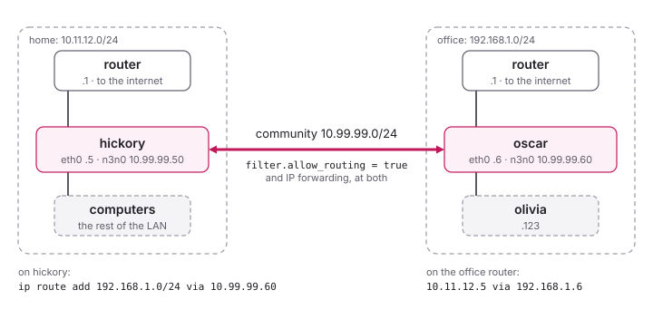

<!--
SPDX-License-Identifier: GPL-3.0-only
SPDX-FileCopyrightText: Copyright 2022 n2n contributors
SPDX-FileCopyrightText: Copyright Logan oos Even
SPDX-FileCopyrightText: Copyright Hamish Coleman
SPDX-FileCopyrightText: Copyright Honey Bunny QT
-->

# Routing

An edge can be a router: for the network behind it, so that the other
edges reach that network, or for all the traffic of another edge, as an
exit to the internet.  This page goes through the common setups with one
example: a home and an office.  The commands are those of Linux; all
traffic through an exit peer (`tuntap.route_all`) works the same on
Windows.



## The example

- Two local networks: **h**ome, 10.11.12.0/24, and the **o**ffice,
  192.168.1.0/24, each with a router at `.1` to the internet.
- In each, a computer with an edge: **h**ickory, 10.11.12.5, and
  **o**scar, 192.168.1.6, both connected through `eth0`.
- Their n3n-be devices are `n3n0`, with 10.99.99.50 (hickory) and
  10.99.99.60 (oscar) in the community's 10.99.99.0/24.

## What a routing edge needs

On every edge that forwards packets - here hickory and oscar:

1. `filter.allow_routing = true`: without it, the edge drops the packets
   from the community that are not for its own address.
2. IP forwarding in the kernel: `sudo sysctl -w net.ipv4.ip_forward=1`,
   and the line `net.ipv4.ip_forward=1` in a file in `/etc/sysctl.d/` to
   keep it after a reboot.

## Reaching the office from hickory

On hickory, a route to the office network through oscar:

```sh
ip route add 192.168.1.0/24 via 10.99.99.60 dev n3n0 src 10.11.12.5
```

and on oscar, the way back to hickory:

```sh
ip route add 10.11.12.5 via 10.99.99.50 dev n3n0 src 192.168.1.6
```

Now hickory and oscar reach each other at their own addresses, 10.11.12.5
and 192.168.1.6.  For the other computers of the office, the answers to
hickory have to find their way to oscar too - three ways, best first:

- **A route on the office router**, which most routers allow in their
  web interface: "10.11.12.5 (or 10.11.12.0/24) via 192.168.1.6".  One
  place, and every computer of the office reaches hickory.
- **A route on each office computer** that is to reach hickory, e.g. on
  olivia, 192.168.1.123:
  `ip route add 10.11.12.5 via 192.168.1.6 dev eth0 src 192.168.1.123`.
- **NAT on oscar**, when neither is possible: oscar makes hickory's
  packets look like its own.  Then only hickory can start connections to
  the office, not the other way round:

    ```sh
    iptables -t nat -A POSTROUTING -o eth0 -j MASQUERADE
    iptables -A FORWARD -i eth0 -o n3n0 -m state --state RELATED,ESTABLISHED -j ACCEPT
    iptables -A FORWARD -i n3n0 -o eth0 -j ACCEPT
    ```

The other way round - hickory reachable from the whole office, or the
office from the whole home network - is the same with home and office
swapped.

## Both whole networks

For every computer of each network to reach every computer of the
other, widen the routes from hickory's address to its network:

- on oscar: `ip route add 10.11.12.0/24 via 10.99.99.50 dev n3n0 src 192.168.1.6`
- on hickory: `ip route add 192.168.1.0/24 via 10.99.99.60 dev n3n0 src 10.11.12.5`
- on the office router: 10.11.12.0/24 via 192.168.1.6, and on the home
  router 192.168.1.0/24 via 10.11.12.5 (or routes on the computers, as
  above)

NAT alone, on both sides, does not work here: at least one side needs
routes.

## All internet traffic through the office

Hickory's traffic to the internet can leave through the office, as with
a VPN service - for a laptop on the road, say.  All its traffic then
appears to come from the office.

Oscar needs NAT (the `iptables` lines above): the office router
forwards only what comes from its own network.  Oscar also needs its
route back to hickory.

Once it has, oscar's edge finds out by itself, by a probe through its
host to the supernode and back, and announces itself to its peers as an
exit to the internet (`tuntap.exit`, see [What an Edge Tells Its
Peers](Announcements.md#exits-to-the-internet)): its peers' lists of
exit peers - the tray app's, the web page's, the Android app's - show it
as one, first.

On hickory, the edge does the rest with `tuntap.route_all`, as the
Android app does with its "Route all traffic through a peer" - on Linux
and on 64-bit Windows alike:

```ini
[tuntap]
gateway = 10.99.99.60
route_all = true
dns = 1.1.1.1
```

or `-O tuntap.gateway=10.99.99.60 -O tuntap.route_all=true -O
tuntap.dns=1.1.1.1` on the command line.  While the edge runs, all of
hickory's traffic goes to oscar, IPv6 included (see below), and DNS to
`tuntap.dns` through the tunnel; the edge's own traffic - to the
supernodes, and to the peers it reaches directly, wherever they are -
stays outside; its local networks stay as they were.  When the edge
stops, it takes it all back.  `tuntap.address_mode` has to be `static`
or `auto`, as the edge reaches oscar in the device's subnet.

How the edge's own traffic stays outside, without a route for each
supernode and peer:

- **Linux**, as wg-quick does it: the edge's sockets carry the firewall
  mark 0x6e33, and two policy rules send everything else to a routing
  table of its own, 0x6e33 (28211), whose default route goes through
  oscar:

    ```
    $ ip rule
    32764:  from all lookup main suppress_prefixlength 0 proto 110
    32765:  not from all fwmark 0x6e33 lookup 28211 proto 110
    $ ip route show table 28211
    default via 10.99.99.60 dev n3n0 proto 110
    ```

    The first rule keeps the main table's routes but its default ones -
    the local networks, the community's subnet.  The edge keeps
    CAP_NET_ADMIN after dropping its privileges, for the sockets it
    opens later and for taking the rules back.  Strict reverse path
    filtering (`net.ipv4.conf.all.rp_filter = 1`, the default of some
    distributions) drops what the supernodes and peers send then, as the
    way back to them looks as if it went into the tunnel; the edge warns
    of it, and `2` (loose) lets it in.  `tuntap.dns` goes to
    systemd-resolved (`resolvectl`), for all names; without it, the DNS
    servers stay as they are.
- **Windows**, as WireGuard for Windows does it: the edge's sockets are
  bound to the interface of the best default route (`IP_UNICAST_IF`),
  and `0.0.0.0/1` and `128.0.0.0/1` go through oscar on the TAP adapter -
  more specific than the default route, which stays for the edge.  When
  the default route moves to another interface (WiFi to Ethernet, say),
  the edge binds its sockets anew and registers again.  The adapter gets
  `tuntap.dns` and the metric 1 (unless `tuntap.metric` gives one), and
  a rule of Windows' Name Resolution Policy Table (NRPT, the local one in
  the registry) for all names (`.`) to `tuntap.dns`: on its own, the
  adapter's DNS server is only one of those Windows asks at once - the
  other interfaces' servers, outside the tunnel, would still get every
  name.  `Get-DnsClientNrptRule` shows the rule, "n3n-be" and the
  adapter's name; it goes with the routes, and one left behind by an edge
  that did not get to take it back goes when the edge opens its adapter
  again.  Where group policy has NRPT rules, Windows ignores the local
  ones; the edge says so in its log.

IPv6 goes into the device too, so that it does not go around oscar.  It
gets through only with a TUN device and `tuntap.address6`, to an exit
peer that routes IPv6; otherwise it goes nowhere, and programs fall
back to IPv4.

### Switching while it runs

As in the Android app, the exit peer can be chosen, changed and given up
while the edge runs - from the edge's web page (see
[the management API](../internals/ManagementAPI.md#the-web-page)), where
each peer has a button "route all" and "All traffic" says through which
peer it goes, with a button to stop; or with `n3n-be-ctl`:

```sh
n3n-be-ctl -k PASSWORD set_gateway 10.99.99.60            # through oscar
n3n-be-ctl -k PASSWORD set_gateway 10.99.99.60 1.1.1.1    # and that DNS server
n3n-be-ctl -k PASSWORD set_gateway ""                     # through none
```

`get_info` says how it is: `gateway`, `route_all` (1 while all traffic
goes through it) and `dns`.  A reload that changes `tuntap.gateway`,
`tuntap.route_all` or `tuntap.dns` in the configuration applies them the
same way.  What was switched lasts until a restart, or until a reload
changes those options in the file.  Moving to another exit peer keeps all
traffic in the tunnel meanwhile: the new routes come before the old ones
go.  Giving up the exit peer leaves `tuntap.route_all` as it is, waiting
for the next one.

- On 64-bit Windows this works in any edge: it knows its sockets from the
  start, and binds them to the default route's interface once it is to
  route all traffic.
- On Linux the edge's sockets carry the firewall mark from their start,
  and the edge keeps CAP_NET_ADMIN, only when it starts with
  `tuntap.route_all = true`.  Such an edge may start without
  `tuntap.gateway`: it routes nothing then, and waits for an exit peer.
  Any other edge answers `set_gateway` with the reason it cannot, and its
  page has no buttons for it.

### By hand

Without `tuntap.route_all` - on other systems, say - the routes are set
by hand, here on Linux:

1. Oscar as above.
2. On hickory, the default route goes through oscar:

    ```sh
    ip route del default
    ip route add default via 10.99.99.60 dev n3n0 src 10.11.12.5
    ```

3. The edge's own packets must not go into the tunnel: hickory keeps a
   route to its home network (`ip route add 10.11.12.0/24 dev eth0 src
   10.11.12.5`, if it was covered by the default route only), and one to
   the supernode through the home router:

    ```sh
    ip route add <supernode address> via 10.11.12.1 dev eth0 src 10.11.12.5
    ```

    The same holds for the public addresses of peers that hickory
    reaches directly, which otherwise go into the tunnel themselves.

`n3n-gateway.sh` next to this page does steps 2 and 3 for the supernode,
and sets a DNS server.  (`tools/n3n-route`, which also added the routes
to the peers, still speaks the old management protocol and does not work
with the current daemons; `tuntap.route_all` does its work.)

With a TUN device (`tuntap.type = tun`), `tuntap.gateway` names the peer
that takes the packets for other networks, see
[Configuration Options](../configure/Options.md#tuntapgateway).

### DNS

If the supernode is given by name, hickory needs DNS to find it, and
reaches its DNS server outside the tunnel - its home router, or a route
for a public DNS server.  That leaks DNS queries past the tunnel: they
reveal what hickory looks up, while the rest of its traffic goes through
the office.

To avoid such a [DNS leak](https://en.wikipedia.org/wiki/DNS_leak),
resolve the supernode's address separately - e.g.
`dig +short sn.example.org @8.8.8.8` in the script that starts the edge,
with a route for 8.8.8.8 outside the tunnel - and give hickory, for
everything else, a DNS server that it reaches through the tunnel: the
office's, or another public one than the one used for the supernode.  A
change of the supernode's address then goes unnoticed until the script
runs again.  <https://www.dnsleaktest.com/> shows whether queries leak.

With `tuntap.route_all` and `tuntap.dns`, the supernodes' names are
looked up once outside the tunnel, when the edge starts and before its
routes are there; the lookups the edge does later go through the
tunnel, to `tuntap.dns`, as all others do.
