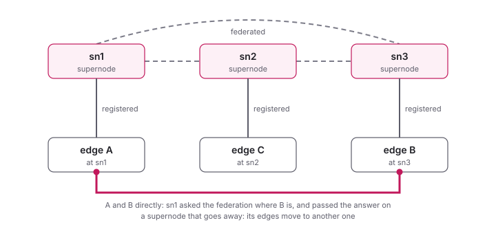

<!--
SPDX-License-Identifier: GPL-3.0-only
SPDX-FileCopyrightText: Copyright 2020 n2n contributors
SPDX-FileCopyrightText: Copyright Hamish Coleman
SPDX-FileCopyrightText: Copyright Honey Bunny QT
-->

# Supernode Federation

Several supernodes can work together as a **federation**: an edge
registers at any of them and still finds the edges registered at the
others.  When a supernode goes away, its edges move to another one, and
the network keeps working.  The load is spread over the supernodes as
well.



## Setting one up

Each supernode is given the federation's name and at least one other
supernode of it, as `supernode.peer`.  Two supernodes, at 198.51.100.1
and 198.51.100.2, each with this configuration, but `peer` pointing at
the other:

```ini
[supernode]
federation = myFederation
peer = 198.51.100.2:7654
```

The supernodes tell each other about the others, so a third one only
needs to know one of them.  `peer` can be given more than once.

The edges are given one supernode of the federation, or better several,
in case the one they know is down when they start:

```ini
[community]
name = mynetwork
key = mysecretpass
supernode = 198.51.100.1:7654
supernode = 198.51.100.2:7654
```

They learn about the other supernodes of the federation from those they
reach.

The federation's name is the same on all its supernodes.  Without one,
it is `Federation`, and the supernodes warn that this is for testing
only: with [user/password authentication](Authentication.md), the name
is part of the keys, so it should be a secret of the supernodes.  It can
also come from the environment, `N3N_FEDERATION`.

With user/password authentication, every supernode of the federation
needs the same users - the same `[community NAME]` sections or community
file - and the edges the federation's public key, `auth.pubkey`, which
`n3n-be-edge tools keygen <federation name>` prints.

## How it works

The supernodes register at each other as edges register at a supernode,
in a community of their own: the federation (its name starts with a `*`
inside, so that no community of edges can have it).  In their answers,
they tell each other - and the edges - about the supernodes they know.

A supernode passes an edge's question about a peer on to the others of
the federation, and their answer back: so edges registered at different
supernodes find each other, and reach each other directly where their
NATs allow, as in the picture.  What has to be relayed is relayed across
the federation.

## Which supernode an edge uses

An edge pings the supernodes it knows now and then, and registers at
one of them, by `connection.supernode_selection`:

| strategy | the edge chooses |
|----------|------------------|
| `load` (default) | the supernode with the least load, which spreads the edges over the federation |
| `rtt` | the one with the shortest round trip, the "closest" |
| `mac` | the one with the lowest MAC address |

The edge reconsiders with each registration, with some reluctance to
move, so that it does not jump between supernodes of about the same
load or distance.

### IPv4 and IPv6

An edge that knows a supernode by an IPv4 and an IPv6 address
(`supernode = 198.51.100.1:7654` and `supernode =
[2001:db8::1]:7654`) registers its address of either family there.  The
supernode keeps both, and tells each edge that asks for a peer the
address of a family both have, IPv6 first: two edges with IPv6 reach
each other over it, NAT or not, and one with IPv4 only still gets the
other's IPv4 address.

So for any strategy, an edge prefers a supernode over IPv6 a little: an
IPv4 entry counts half again as much as it is (load, round trip), and
loses a tie; by round trip, the current supernode counts a quarter less,
so the edge only moves to one clearly faster.  A far IPv6 supernode
still loses to a near IPv4 one.  A supernode given by both addresses is
two entries, each with its own round trip; an address that does not
answer, behind a firewall say, has no say.  With an older supernode that
keeps one address only (it says so in its answers), the edge registers
over IPv6 wherever one answers there.

Between the edges, the same order holds for the ways to a peer: its LAN
address first (private IPv4, or a unique local IPv6 address), then public
IPv6, then public IPv4.  A peer heard from at a better address moves
there at once; one heard from at a worse one stays where it is, as long
as it answers there.

## When a supernode goes away

An edge whose supernode stops answering moves to another one of its list
or of the federation within a few registration intervals
(`connection.register_interval`, 20 seconds by default), and
authenticates there again.  Peers that reach each other directly carry
on meanwhile.  The netns scenarios `failover-*` and `sn-tap-failover`
test this, also with encrypted headers, user/password authentication and
TCP, see [Testing behind NATs](../develop/netns_testing.md).
