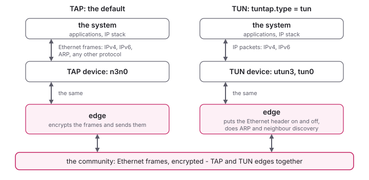

<!--
SPDX-License-Identifier: GPL-3.0-only
SPDX-FileCopyrightText: Copyright 2022 n2n contributors
SPDX-FileCopyrightText: Copyright Logan oos Even
SPDX-FileCopyrightText: Copyright Hamish Coleman
SPDX-FileCopyrightText: Copyright Honey Bunny QT
-->

# The Virtual Network Device

An edge gives its computer a virtual network device: the computer sees
the community through it as an Ethernet network, with an address in it.
Its options are in the `[tuntap]` section.

What the system needs for it:

- **Linux**: nothing, the TAP and TUN drivers come with the kernel (if
  not loaded, `sudo modprobe tun`).
- **Windows**: the TAP driver of OpenVPN, `tap-windows6`, see
  [Installing](../quick_start/Install.md#windows).
- **macOS**: nothing with `tuntap.type = tun`, which uses macOS's own
  `utun` device, see [Build on macOS](../build/macos.md#run-on-macos).
- **Android**: the app uses the system's VPN service.

## TAP or TUN



By default the edge uses a **TAP** device, which carries Ethernet frames:
everything a network card would, IPv4, IPv6, ARP and any other protocol.

With `tuntap.type = tun` it uses a **TUN** device instead, which carries
IP packets only.  The edge then puts the Ethernet header on and takes it
off itself, answers ARP for its own address, and finds the MAC addresses
of the others from what they announce, or by asking with ARP - and does
neighbour discovery for IPv6 the same way.  On the wire nothing changes:
edges with TUN and with TAP devices are in the same community.

TUN is for systems that offer only TUN devices - Android, and macOS -
and works on Linux too, where the tests use it.  For now it has no
bridging, no `dhcp` address mode and one thread.  Routes and addresses
work as with a TAP device; the neighbour entries are the edge's own,
`ip neigh` does not show them.

## Name

`tuntap.name` names the device, for `ip`, `iptables`, `tcpdump` and the
like:

```ini
[tuntap]
name = n3n0
```

Without it, the device is called after the session, with a `0`:
`edge0` for the session `edge`, `mynetwork0` for `mynetwork.conf`.  On
Windows, where the TAP adapters come with fixed names, `tuntap.name`
picks one of them, by name, if there is more than one;
`n3n-be-edge help adaptors` lists them.

## IPv4 address

`tuntap.address_mode` says where the address comes from:

- **`auto`** (the default): the supernode hands one out.  Each community
  gets a /24 of its own, from `10.128.0.0` to `10.255.255.0` by default,
  so all the edges of a community are in one subnet; the supernode's
  `supernode.auto_ip_min` and `supernode.auto_ip_max` set another range,
  and a community's `network` a fixed one (see
  [Communities](Communities.md)).  Which address an edge gets depends on
  its description (`connection.description`, by default the host name), so
  it usually gets the same one again.
- **`static`**: the address of `tuntap.address`, with its prefix length
  (`/24` if none is given).  `tuntap.address` alone is not enough, the
  mode has to say `static`:

    ```ini
    [tuntap]
    address = 10.77.0.5/24
    address_mode = static
    ```

    On the command line, `-a 10.77.0.5/24` does both.
- **`dhcp`**: the edge sets no address, and a DHCP client on the device
  asks the DHCP server of the community - one that an edge of the
  community runs, or one behind a bridge.  The edge needs
  `filter.allow_routing = true` for that.  Not with TUN.

## IPv6 address

IPv6 inside the tunnel needs an address on each edge's device,
`tuntap.address6`:

```ini
[tuntap]
address6 = auto
```

`auto` makes an address that is the edge's own, without anyone handing
it out and without anything new on the wire:

- the network (the upper 64 bits) is `tuntap.prefix6`, by default `fd`
  and 40 bits of a hash of the community's name - the same private /64
  for all the edges of a community;
- the lower part is the edge's IPv4 address: with 10.77.0.5,
  `fd6c:bcdb:8e7b::10.77.0.5` (shown as `fd6c:bcdb:8e7b::a4d:5`); an edge
  without one takes its MAC address, as the kernel does for the
  link-local address.

Or give one: `address6 = fd00:77::5/64`.  The edge puts it on the device
(Linux and macOS) and logs it ("IPv6 address of the device").  Neighbour
solicitations, IPv6's ARP, then pass without `filter.allow_multicast`.
Test it with `ping -6`.  The design, and what comes next:
[IPv6](../develop/IPv6.md).

An address added by hand works as well (`ip -6 addr add fd00:77::7/64
dev n3n0` at each end), but then neighbour discovery needs
`filter.allow_multicast = true`.

(This is IPv6 inside the tunnel.  Between the edges and the supernodes,
n3n-be speaks IPv6 as well, see `connection.bind` and
`community.supernode`.)

## MAC address

The device has a MAC address, which identifies the edge in the
community, and must be unique there.  By default the edge makes up a
random one; `tuntap.macaddr` sets one, so that it stays the same from one
start to the next.

## MTU

The edge wraps each frame into a packet of its own - a header, and the
cipher's padding - so the frames on the device have to be smaller than
the packets the internet carries.  The default MTU, 1290, makes packets
of up to about 1440 bytes on the wire (relayed over IPv6 with AES), which
fits paths of 1500 bytes and 1492 bytes (PPPoE).

On a smaller path - 1280 bytes, the IPv6 minimum, which some mobile
networks and tunnels inside tunnels leave - larger packets get
fragmented, and get lost where fragments are dropped.  There, set

```ini
[tuntap]
mtu = 1128
```

on the edges of the community: that fits a 1280 byte path in every
case.

The edge does not find the MTU of a path by itself yet (see
[Path MTU](../develop/PathMtu.md)).  It sends its packets without the
"don't fragment" flag, so that a router on the way fragments a packet
that is too large instead of dropping it; `connection.pmtu_discovery =
true` sets the flag, and leaves the path MTU discovery to the system.
`tracepath` shows the MTU of a path.

## Broadcast and multicast

**Broadcast** (`ff:ff:ff:ff:ff:ff`) always passes: ARP, DHCP, and the
games and services that look for each other.  On Windows, broadcasts go
out of the interface with the lowest metric only, usually the internet
one (metric 25); `tuntap.metric` gives the TAP adapter a lower one, so
that such services find each other over n3n-be.

**Multicast** does not pass by default.  `filter.allow_multicast = true`
lets it through, on each edge that is to send or to receive it: each
drops it both ways otherwise, and counts it (`multicast_drop` in
`n3n-be-ctl get_packetstats`).  With the option, n3n-be carries multicast as
a switch does: a frame to a multicast MAC goes to every edge of the
community.

| destination MAC | for | `allow_multicast` |
|-----------------|-----|-------------------|
| `ff:ff:ff:ff:ff:ff` | broadcast: ARP, DHCP, IPX, NetBIOS over IP, Wake-on-LAN, games looking for each other | always passes |
| `01:00:5e:...` | IPv4 multicast: SSDP (DLNA, UPnP), mDNS, IGMP | passes if allowed |
| `33:33:...` | IPv6 multicast: neighbour discovery (its solicitations pass anyway once the edge has an IPv6 address, see above), mDNS, SSDP | passes if allowed |
| other multicast MACs | protocols without IP: NetBEUI's NetBIOS (`03:00:00:00:00:01`) of old Windows and DOS programs, AppleTalk (`09:00:07:...`), PROFINET's discovery DCP (`01:0e:cf:...`), Cisco's CDP and others | passes if allowed |
| `01:80:c2:00:00:00` to `0f` | IEEE 802.1 link-local: spanning tree, LACP, 802.1X, LLDP, pause frames | never passes |

The last row never passes, whatever the option: these frames are about
the link they are sent on, and no bridge forwards them (IEEE 802.1D and
802.1Q).  Over a VPN they would do harm: pause frames from one site would
throttle a link at another, spanning tree would take the far end of the
tunnel for part of its own segment, 802.1X would try to authenticate
across it, and LLDP would show devices a neighbour at the far end (and
tools such as TIA Portal a topology that is not there).  The edge drops
them both ways and counts them in `multicast_drop`.

Multicast goes through the supernode to every edge of the community, as
broadcast does, and each edge's option decides on the way out and on the
way in.  A supernode of n3n-be 3.4.8 or older, of upstream n3n or of n2n
passes on only the IPv4 and IPv6 multicast: through it, frames to other
multicast MACs are lost; and such an edge takes them in whatever its
option says.  With a bridge (`filter.allow_routing`, see
[Bridging](../advanced/Bridging.md)) they reach the devices behind it, as
a PLC's discovery needs.  With a TUN device there is IP only, so IPv4
and IPv6 multicast.

## Description

`connection.description` is the edge's name in the management output of
the edges and supernodes: by default the host name.  With automatic
addresses, the supernode picks the address from a hash of it, so a new
host name can mean a new address; two edges with the same description
(two edges on one host, say) would get the same one, and the second is
refused (see [the FAQ](../FAQ.md)).  With users and passwords, the
description is the user name, see [Authentication](Authentication.md).

## Routing and filtering

By default, an edge drops the packets from the community that are not
for its own address.  To route for a network behind it, or to bridge, see
[Routing](../advanced/Routing.md) and [Bridging](../advanced/Bridging.md)
(`filter.allow_routing`).  To restrict the traffic, see
[Traffic Restrictions](../advanced/TrafficRestrictions.md) (`filter.rule`).
